# BFB321 Group 10: Lebombo Border Post Truck Flow System

This project is a web-based solution for insufficient flow of information in the Lebombo border post that connects South Africa to Mozambique. Trucks, drivers and goods informations are carried from Canopy 1, to the immigration office and are cleared and exit at Canopy 2. Queueing theory is used to allocate each truck to a parking lane and admin window, with the supply chain model showing live KPIs. The solution replaces the redundant capturing of paper based data at every station.

## Group members

| Name | Student number | GitHub username |
| --- | --- | --- |
| Micah Janse van Rensburg | u23552931 | micah-jvr & micah-jvr-UP |
|Carine Pretorius | u24568962 | u24568962 |
| Chardi Snyman | u24595986 | ChardiSny |

## Task allocation

* **Micah**: flask routes, edit and update flow, JSON API, login with roles, report: final concept and architecture, technology integration, user journey and workflow, sustainability and scalability, conclusion
* **Carine**: database models file, transactions, lane and window allocation, dashboard KPIs, M/M/c model, immigration and Canopy 2 boards, README, report: implementation guide
* **Chardi**: front end, the base layout, the registration, goods and lane pages, styling, report: executive summary, user journey and workflow, risks and mitigation, reflections and key learnings

## Technologies used

| Layer      | Technology                         |
|------------|------------------------------------|
| Front end  | HTML, Bootstrap 5, Jinja2          |
| Back end   | Flask (Python)                     |
| Database   | MySQL on Aiven, accessed via PyMySQL |
| Models     | Python supply chain models         |

## How to run the solution

1. Clone the repository and open the folder in VS Code
   ```bash
   git clone https://github.com/u24568962/BFB321_Group10_Group_Assignment.git
   cd BFB321_Group10_Group_Assignment
   ```
2. Create and activate a virtual environment, then install the packages
   ```bash
   python -m venv venv
   venv\Scripts\activate          
   pip install -r requirements.txt
   ```
3. Create a free MySQL service on https://console.aiven.io, wait until it says
   Running, and create a database called `lebombo`.
4. Copy the settings template and fill in your Aiven values
   ```bash
   copy .env.example .env        
   ```
5. Build the tables and load the sample data
   ```bash
   python init_db.py --reset
   ```
6. Start the app and open http://127.0.0.1:5000
   ```bash
   python app.py
   ```
7. Run the tests
   ```bash
   python -m pytest -v
   ```

### Test sign-in credentials (demo accounts)

| Username | Password | Role | Can open |
|---|---|---|---|
| admin | admin-demo | admin | everything |
| canopy1 | canopy1-demo | canopy1 | overview, Canopy 1 |
| immigration | immigration-demo | immigration | overview, Canopy 1, immigration |
| canopy2 | canopy2-demo | canopy2 | overview, Canopy 1, Canopy 2 |

The JSON API (`/api/...`) does not need a login so it can be tested with a browser
(see Limitations).

## User flows

1. **Canopy 1 (create):** register driver and truck -> confirm or edit details -> declare goods -> the model allocates a lane and an admin window
2. **Immigration office (update):** see the queue per window with passport and goods already filled
   in -> Start processing -> Stamp passport and clear
3. **Canopy 2 (update):** see cleared trucks -> Sign out truck and frees the lane
4. **Overview dashboard (read):** live KPIs that change after every action above

## Supply chain models

* `supply_chain/lane_allocation.py`: processing time = 4 min + minutes per declared goods category
  (+2 min for other goods); each truck goes to the non-full lane with the least workload
  (ties -> lowest lane number). Predicted wait = workload already in that lane.
* `supply_chain/queueing_theory.py`: M/M/1 and M/M/c formulas. The dashboard feeds it live
  data (λ = arrivals in the last hour, μ = 1 / average processing time, c = open windows) to
  predict the wait at the admin windows and the window utilisation.

Both are plain Python with no Flask or database code, and are unit-tested in `tests/`.

## KPIs on the dashboard

1. Trucks in border now
2. Arrivals today (% vs yesterday)
3. Exits today
4. Average turnaround today
5. Average wait for immigration today
6. Trucks per stage
7. Arrivals per hour (last 12 h) 
8. Lane occupancy and alerts
9. M/M/c predicted wait
10. Utilisation and P(wait).

## Database

9 tables in third normal form

* `drivers`, `trucks`: stored once, reused for every crossing (UNIQUE passport, licence, registration)
* `crossings`: one trip through the border; status moves registered → goods_declared →
  allocated → at_immigration → cleared → exited, with a timestamp for each step
* `goods_categories` + `crossing_goods`: many-to-many link between crossings and goods
* `lanes`, `admin_windows`: capacity and open/closed state
* `status_events`: audit trail of every status change and who made it
* `users`: staff accounts with roles

Indexes: `crossings(crossing_status)`, `(lane_id, crossing_status)`, `(window_id, crossing_status)`,
`(arrived_at)`, `status_events(crossing_id, created_at)`.

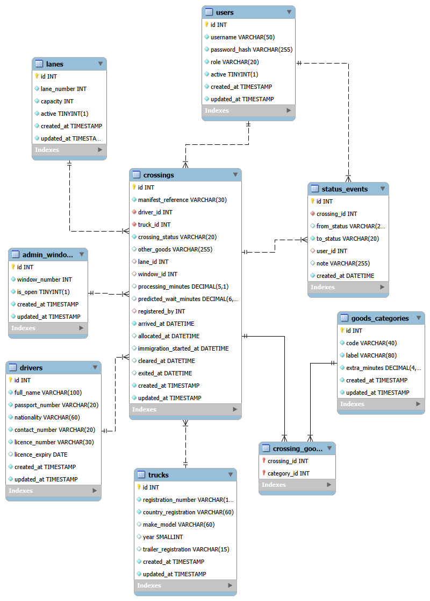

## REST API

| Method | Path | Purpose | Success | Errors |
|---|---|---|---|---|
| GET | `/api/crossings?status=&page=&size=` | List crossings, filter by status, paginate | 200 | 400 |
| GET | `/api/crossings/<id>` | One crossing with goods | 200 | 404 |
| POST | `/api/crossings` | Register driver + truck (Canopy 1) | 201 | 400, 409 |
| PUT | `/api/crossings/<id>` | Update driver + truck details | 200 | 400, 404, 409 |
| PUT | `/api/crossings/<id>/goods` | Declare goods | 200 | 400, 404, 409 |
| POST | `/api/crossings/<id>/allocate` | Allocate lane + admin window (model) | 200 | 404, 409 |
| POST | `/api/crossings/<id>/advance` | Immigration / Canopy 2 next step | 200 | 404, 409 |
| GET | `/api/lanes` | Lane occupancy and workload | 200 | |
| GET | `/api/kpis` | Dashboard KPIs + M/M/c prediction | 200 | |

Send every JSON value as a string (for example `"year": "2021"`).

## Project structure

```
app.py              routes (HTML pages) + error handlers + logging
api.py              Blueprint with the JSON API (/api/...)
models.py           SQL + business rules (calls the supply chain models)
db.py               MySQL connection per request, query helpers, rollback on failure
config.py           Development / Testing / Production settings (FLASK_ENV)
init_db.py          builds the tables and loads seed data (--reset to rebuild)
schema.sql          CREATE TABLE statements
seed.sql            sample data
supply_chain/       lane_allocation.py, queueing_theory.py (standalone, tested)
templates/          Jinja2 pages (base.html is the shared layout)
static/css/         style.css
tests/              pytest unit + integration tests
docs/               ERD image and screenshots
```

## Configuration

Copy `.env.example` to `.env`. `FLASK_ENV` selects the settings in `config.py`:
`development` (debug on), `testing` (uses `TEST_DB_NAME`), `production` (no debug, friendly
error pages only). `LOG_LEVEL` sets the logging level. `.env` is in `.gitignore` and is never committed.

## Errors and logging

* 400 / 404 / 405 / 500 return JSON under `/api/` and a friendly page elsewhere; no tracebacks
  are shown outside development.
* Every write runs in a transaction; a failure rolls back (see `models.py` and `db.close_db`).
* Logs (time, level, message) go to the console and to `logs/app.log`.

## Backup, restore and rollback

Needs the MySQL command-line client (`mysqldump`, `mysql`).

```bash
# back up (the backups/ folder is in .gitignore)
mysqldump -h <DB_HOST> -P <DB_PORT> -u avnadmin -p --ssl-mode=REQUIRED lebombo > backups/lebombo_YYYY-MM-DD.sql
# restore
mysql -h <DB_HOST> -P <DB_PORT> -u avnadmin -p --ssl-mode=REQUIRED lebombo < backups/lebombo_YYYY-MM-DD.sql
```

* **Schema change (migration):** edit `schema.sql`, take a backup, then run `python init_db.py --reset`.
* **Rollback of a failed change:** `git checkout <previous commit> -- schema.sql seed.sql`, run
  `python init_db.py --reset`, and restore the latest backup if real data must come back.
* Aiven also takes automatic daily backups of the service (Aiven console → Backups).

## Troubleshooting

| Message | What to do |
|---|---|
| Can't connect to MySQL server ... timed out | Aiven service is asleep, power it on, wait for Running. Check DB_HOST and DB_PORT |
| Access denied for user | DB_USER / DB_PASSWORD wrong, copy the password again from Aiven |
| RuntimeError: 'cryptography' package is required | `pip install -r requirements.txt` (with the venv active) |
| ModuleNotFoundError: No module named 'flask' | The venv is not active, activate it, then install again |
| Unknown database | DB_NAME must match your database name: lebombo |
| Table doesn't exist | `python init_db.py --reset` |
| Changes to .env ignored | Stop the app (Ctrl+C) and start it again |

## Screenshots

### Login

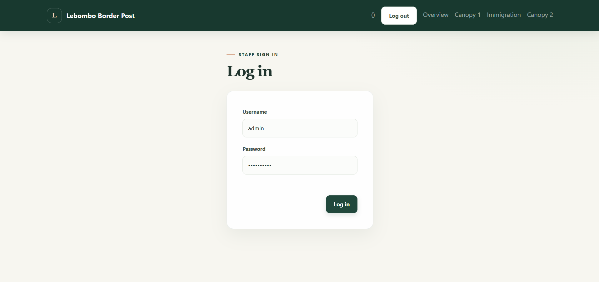

### Overview dashboard

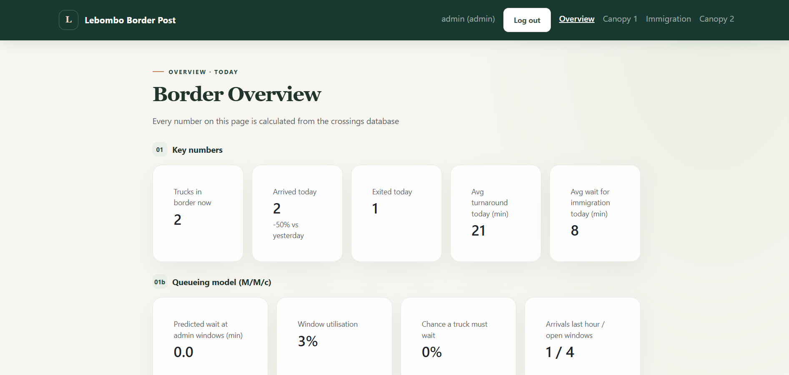
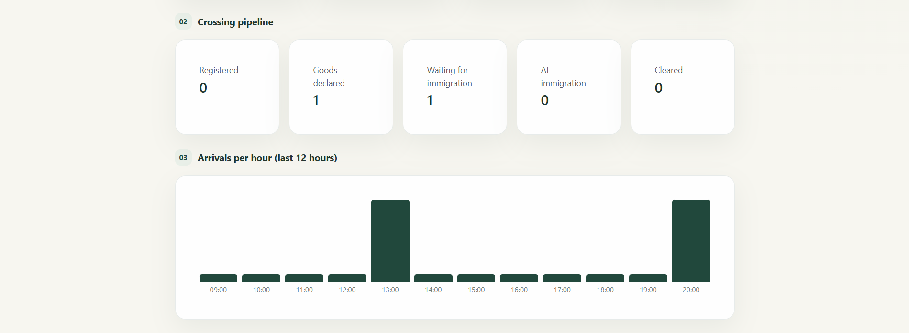
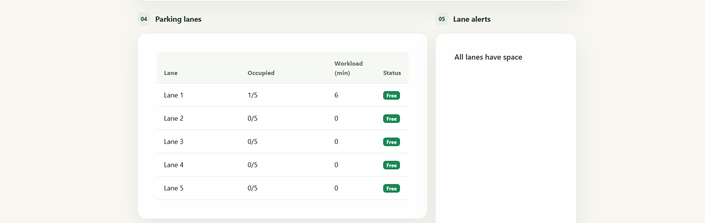

### Canopy 1

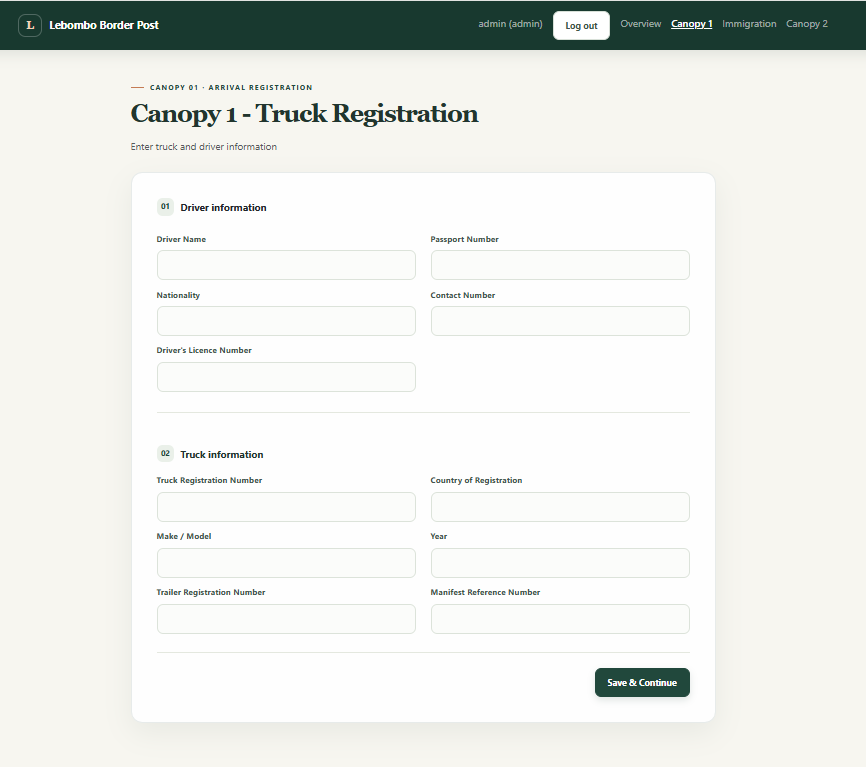
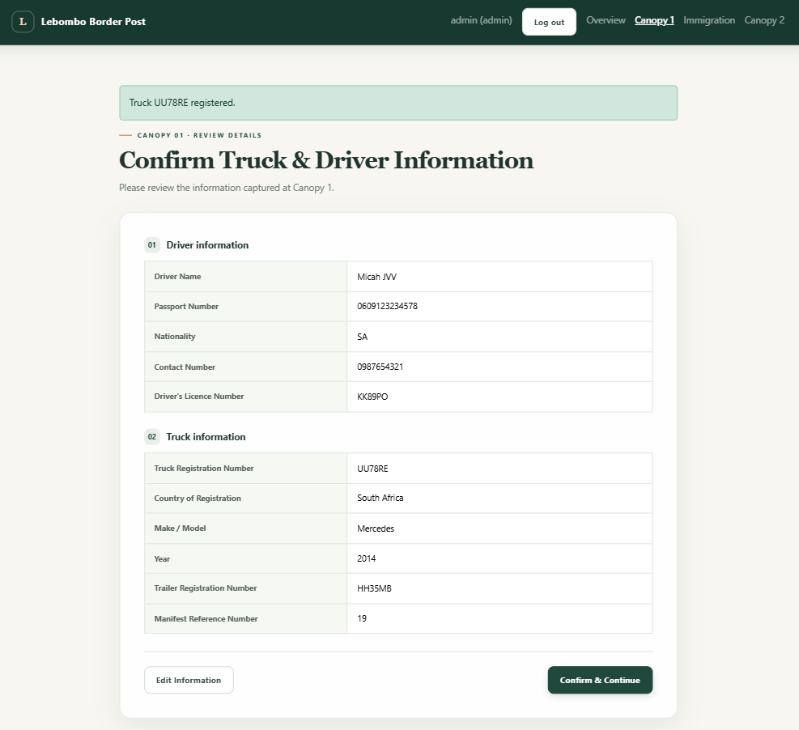
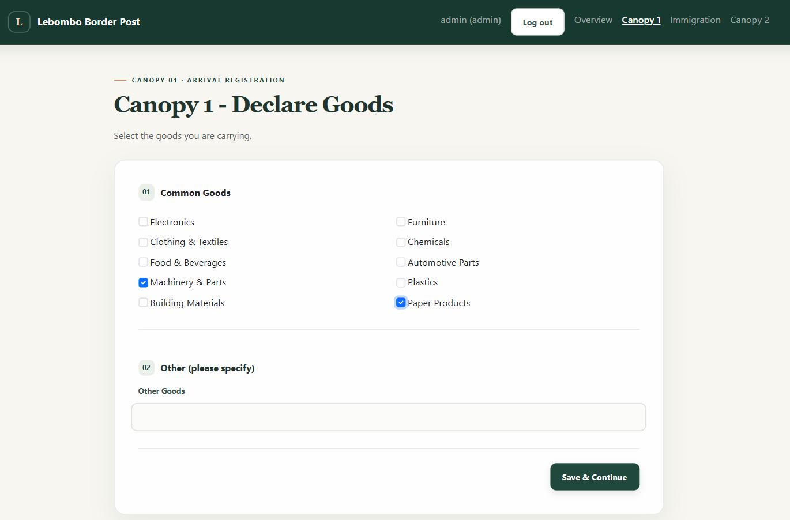
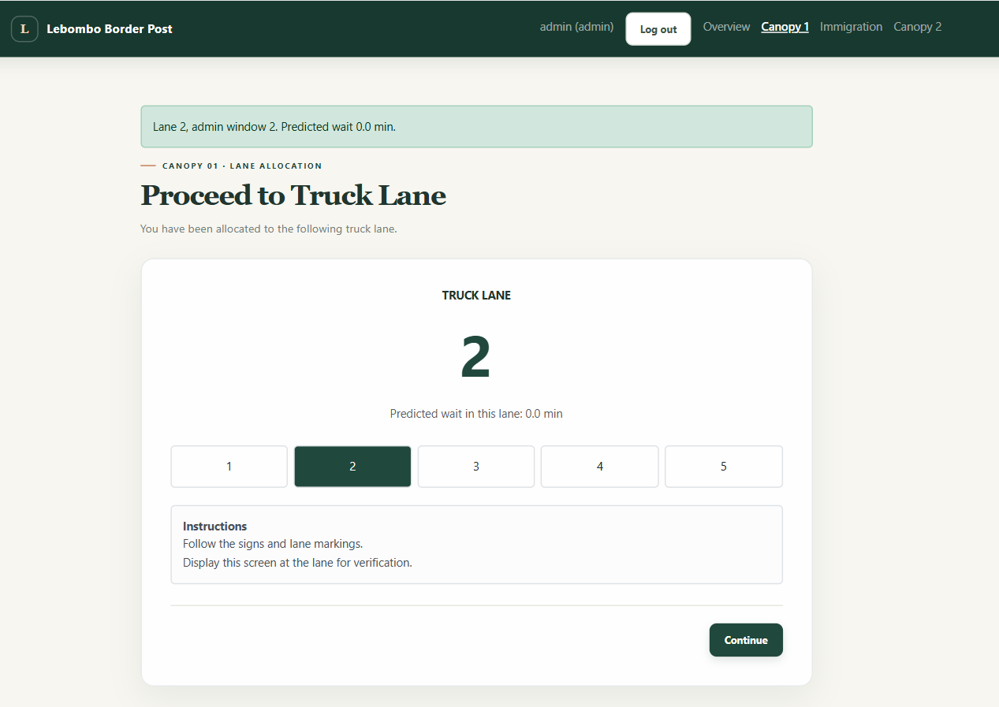
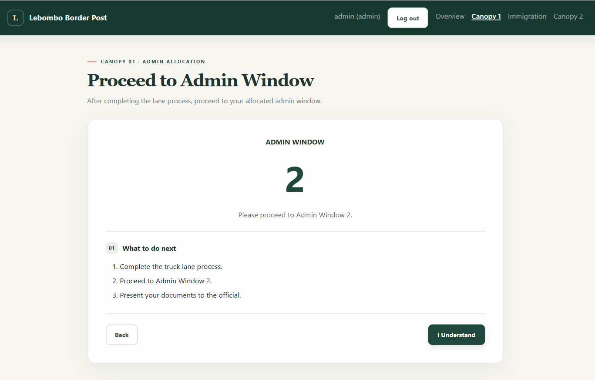

### Immigration office

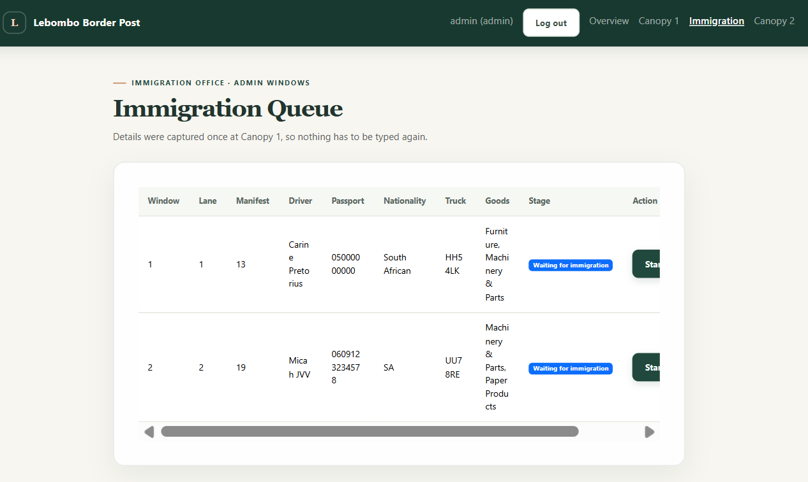
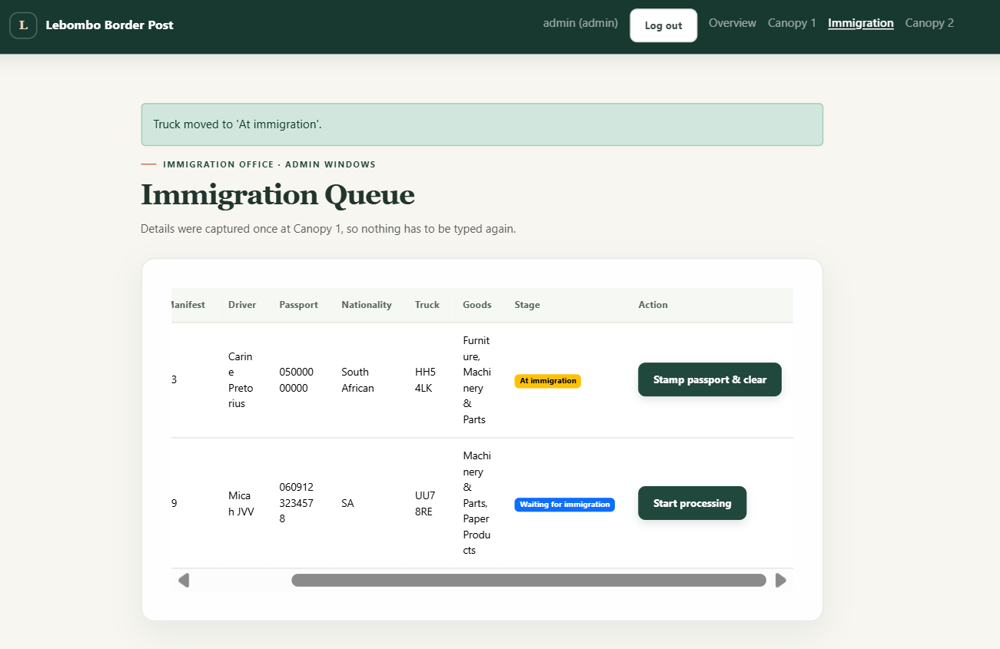

### Canopy 2

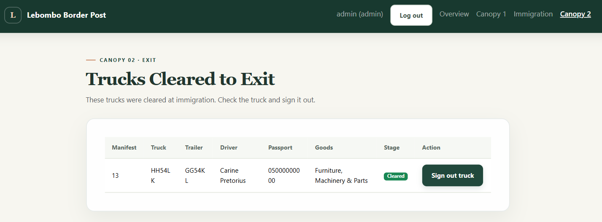

### JSON API

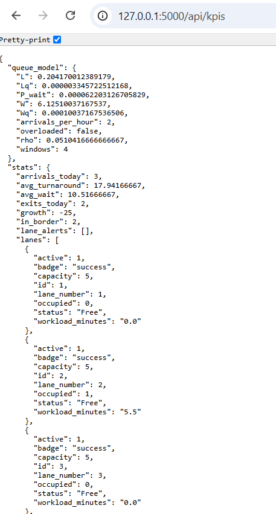
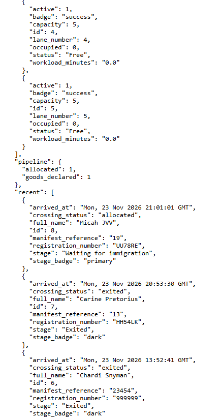

## Limitations and next improvements

* The JSON API is open and requires no login so it can be marked, it needs a token or session check.
* Processing minutes per goods category are estimates and should be updated from measured times.
* The solution is for one border post only. A multi-site would need a `sites` table and a `site_id` on lanes, windows and crossings.
